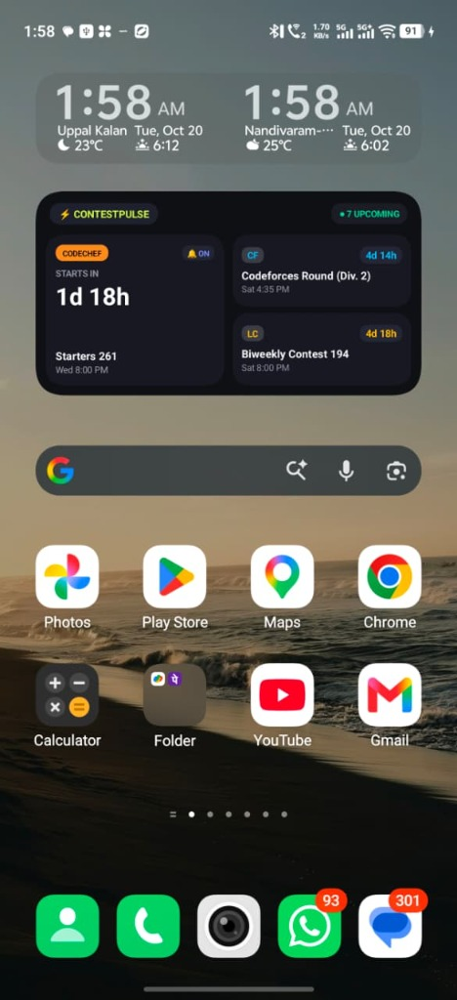
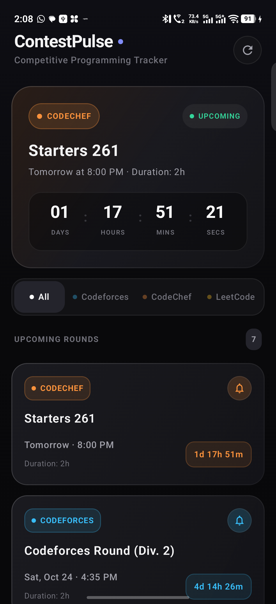

# ⚡ ContestPulse

<div align="center">


**A sleek, modern Android competitive programming tracker with Bento-style home screen widgets and 24/7 reliable ringing alarms.**

[Download Latest APK](release/ContestPulse-v1.0.0.apk) · [Report Bug](https://github.com/bunnysunny24/ContestPulse/issues) · [Request Feature](https://github.com/bunnysunny24/ContestPulse/issues)

</div>

---

## 📱 Screenshots

<div align="center">
  <table>
    <tr>
      <td align="center"><b>Home Screen Bento Widget (4×2)</b></td>
      <td align="center"><b>In-App Contest Dashboard</b></td>
    </tr>
    <tr>
      <td align="center">
        
      </td>
      <td align="center">
        
      </td>
    </tr>
  </table>
</div>

---

## ✨ Features

- 🍱 **Material You Bento Box Widgets (Glance AppWidget)**:
  - **4×2 / 4×3 Bento Grid**: Asymmetric modular grid featuring an elevated **Hero Card** for the immediate next contest with giant countdown typography, alongside stacked secondary platform tiles.
  - **2×2 Bento Hero Square**: Compact square widget focused exclusively on the next upcoming contest with platform pill badges and live countdown.
  - **Zero-clipping, responsive layout**: Designed to look native alongside modern Android 14/15 widgets and search bars.

- 🌐 **Multi-Platform Contest Synchronization**:
  - 🔵 **Codeforces**: Official REST API (`contest.list`) for Div. 1, Div. 2, Div. 3, Div. 4, and Global Rounds.
  - 🟠 **CodeChef**: Real-time Starters and Cook-Offs fetched via CompeteAPI.
  - 🟡 **LeetCode**: GraphQL API for Weekly and Biweekly contests.

- 🔔 **24×7 Reliable Ringing Alarm & Notification System**:
  - **30-minute reminder**: High-priority heads-up notification.
  - **5-minute urgent reminder**: Warning alert to prepare your workspace.
  - **At-start ringing alarm**: Full-screen alarm activity with audio and vibration that rings through lock screens like your phone's native Clock alarm.
  - **Reboot resilience**: `BootReceiver` automatically reschedules all active alarms whenever your phone restarts.

- ⚡ **Offline-First & Battery Efficient**:
  - Room database acts as the single source of truth.
  - WorkManager schedules background sync every 3 hours with network-aware constraints to minimize battery consumption.
  - Swipe-to-refresh for instant manual sync.

---

## 🏗️ Architecture

ContestPulse is built following modern Android Architecture Components and clean MVVM principles:

```
┌────────────────────────────────────────────────────────┐
│                      DATA SOURCES                      │
│   Codeforces REST  │  CodeChef API  │  LeetCode GraphQL │
└──────────────────────────┬─────────────────────────────┘
                           │
                           ▼
┌────────────────────────────────────────────────────────┐
│                   ContestRepository                    │
│             (Single Source of Truth / IO)              │
└────────────┬─────────────────────────────┬─────────────┘
             │                             │
             ▼                             ▼
┌─────────────────────────┐   ┌──────────────────────────┐
│   Room Local Database   │   │  WorkManager Sync Worker │
│     (Offline Cache)     │   │      (Periodic 3h)       │
└────────────┬────────────┘   └──────────────────────────┘
             │
   ┌─────────┴───────────────────────────────┐
   │                                         │
   ▼                                         ▼
┌─────────────────────────┐       ┌──────────────────────────┐
│   Jetpack Compose UI    │       │     Glance Widgets       │
│  (ViewModel + StateFlow)│       │(Bento Grid & Square Hero)│
└─────────────────────────┘       └──────────────────────────┘
   │
   ▼
┌────────────────────────────────────────────────────────┐
│             AlarmManager & Notification Engine         │
│  (Exact Alarms, Foreground AlarmService, BootReceiver) │
└────────────────────────────────────────────────────────┘
```

---

## 📥 Installation

### Option 1: Direct APK Download
Download the pre-compiled APK directly from the repo:
➡️ **[Download ContestPulse-v1.0.0.apk](release/ContestPulse-v1.0.0.apk)**

### Option 2: Build from Source
```bash
# Clone the repository
git clone https://github.com/bunnysunny24/ContestPulse.git
cd ContestPulse

# Build the debug APK
./gradlew assembleDebug

# Install via ADB onto your connected phone
adb install -r app/build/outputs/apk/debug/app-debug.apk
```

---

## 🛡️ 24×7 Background Reliability Setup

To ensure alarms ring on time across aggressive OEM battery managers (iQOO, Vivo, Xiaomi, Samsung, OnePlus):

1. **Battery Unrestricted**:
   - Long-press app icon → **App info** → **Battery** → Select **Unrestricted**.
2. **Enable Autostart**:
   - **App info** → **Permissions / Special app access** → Turn **Autostart** ON.
3. **Exact Alarms & Full-Screen Notifications**:
   - Ensure **Alarms & Reminders** permission is **Allowed**.

---

## 📄 License

This project is licensed under the MIT License - see the [LICENSE](LICENSE) file for details.

---

<div align="center">
  Crafted with ❤️ for competitive programmers by <a href="https://github.com/bunnysunny24">Bunny</a>
</div>
